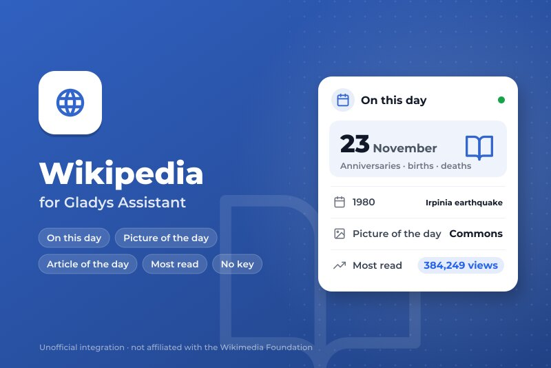
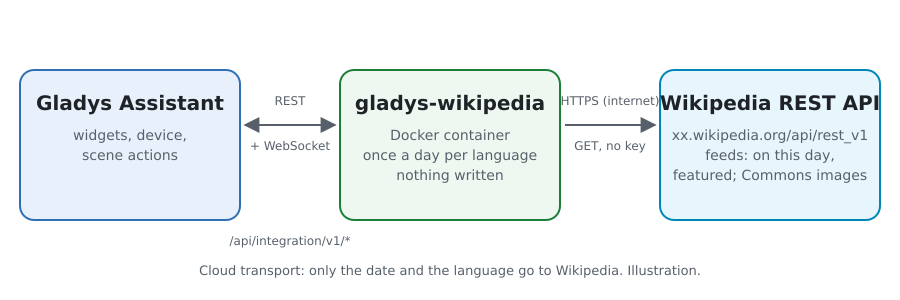
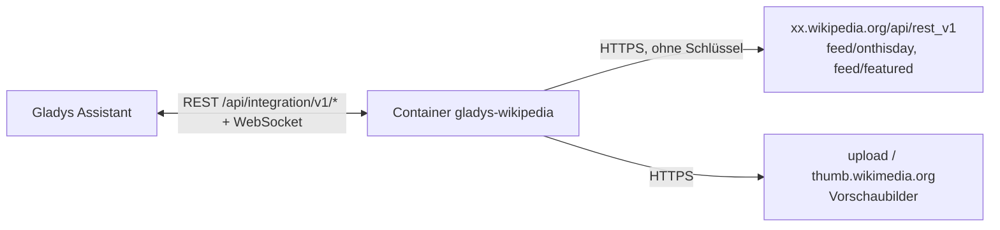
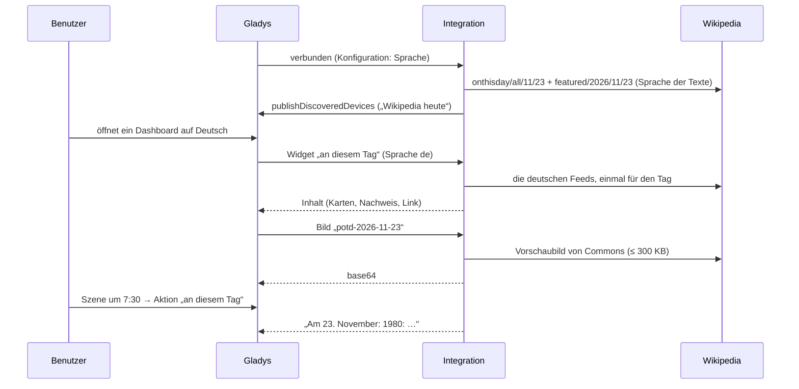
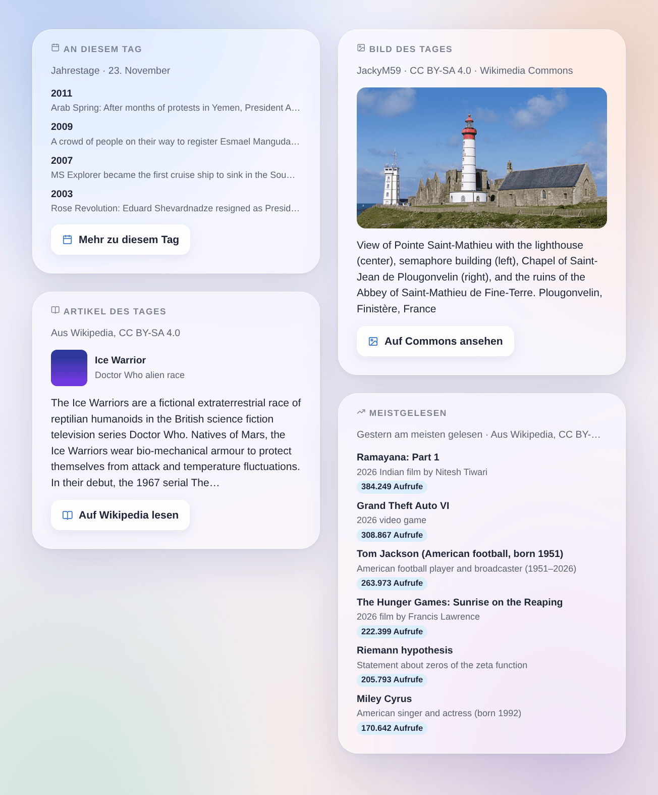

# Gladys Wikipedia

[English](README.md) · [Français](README.fr.md) · **Deutsch** · [Español](README.es.md)

[](LICENSE)
[](https://github.com/William-De71/gladys-wikipedia/releases)
[](https://github.com/William-De71/gladys-wikipedia/actions/workflows/release.yml)
[](https://gladysassistant.com)



Externe Integration für [Gladys Assistant](https://gladysassistant.com) für **[Wikipedia](https://de.wikipedia.org)**: was an diesem Tag geschah, das Bild des Tages, der Artikel des Tages und die meistgelesenen Artikel, auf deinen Dashboards und in deinen Szenen. Kein Konto und kein Schlüssel: Sie liest die öffentlichen Feeds der Wikimedia Foundation, auf Deutsch, Englisch, Französisch und Spanisch.

## Funktionen

- **4 Dashboard-Widgets**, jedes in der Wikipedia der Sprache des Dashboards: an diesem Tag (ausgewählte Jahrestage, Ereignisse, Geburten, Todesfälle oder Feiertage), Bild des Tages, Artikel des Tages, meistgelesen.
- **Ein Gerät** „Wikipedia heute“: Jahrestag, Artikel und Bild des Tages als Texte, für ein Dashboard oder eine Szene.
- **3 Szenenaktionen**: an diesem Tag, Bild des Tages, Artikel des Tages, mit einem Text zum Senden oder Vorlesen.
- Jede genutzte Sprache wird **einmal am Tag** gelesen (zwei Anfragen), beim ersten Bedarf nach Mitternacht in der Zeitzone von Gladys; nichts wird nach `/data` geschrieben.
- Die Texte von Wikipedia stehen unter CC BY-SA 4.0: Jedes Widget nennt Wikipedia, das Bild seinen Urheber und seine Lizenz.
- Vier Sprachen überall: Englisch, Französisch, Deutsch, Spanisch.

## Funktionsweise







### Transport

`transports: ["cloud"]`: Alles geht per HTTPS an `<Sprache>.wikipedia.org` und an die Bildserver von Wikimedia, mit einem User-Agent, der die Integration und ihr Repository nennt, wie es die Etikette der Wikimedia-API verlangt. Nur das Datum und die Sprache verlassen Gladys: kein Konto, kein Schlüssel, keine persönlichen Daten. Nichts wird nach `/data` geschrieben.

## Gerät und Funktionen

| Gerät           | Funktion          | Kategorie / Typ | Inhalt                                                     |
| --------------- | ----------------- | --------------- | ---------------------------------------------------------- |
| Wikipedia heute | An diesem Tag     | `text` / text   | „1976: Jacques Mayol …“ (erster ausgewählter Jahrestag)    |
|                 | Artikel des Tages | `text` / text   | Der Artikel des Tages, sonst der meistgelesene von gestern |
|                 | Bild des Tages    | `text` / text   | Seine Beschreibung                                         |

## Szenenaktionen und Widgets



- **Aktion „Wikipedia: an diesem Tag“**: Felder `kind` (Jahrestage, Ereignisse, Geburten, Todesfälle, Feiertage) und `count` (1 bis 10); Ausgaben `summary` („Am 23. November: 1980: …“), `count`, `first_year`, `first_text`, `page_url`.
- **Aktion „Wikipedia: Bild des Tages“**: Ausgaben `description`, `artist`, `license`, `file_url`, `image_url`.
- **Aktion „Wikipedia: Artikel des Tages“**: Ausgaben `title`, `description`, `extract`, `url`, `most_read` (wahr, wenn die Wikipedia keinen Artikel des Tages hat: Französisch und Spanisch).
- **Widgets**: „An diesem Tag“ (Einstellung: was angezeigt wird; eine Karte pro Eintrag, der vollständige Text und die Artikellinks im Detailbereich, ein Link zur Tagesseite), „Bild des Tages“ (das Bild, seine Beschreibung, Urheber und Lizenz, ein Link zu Commons), „Artikel des Tages“ (Vorschaubild, Anfang der Zusammenfassung, Link), „Meistgelesen“ (mit ihren Aufrufen).

Kein Szenenauslöser: Der Inhalt ändert sich einmal am Tag, eine zeitgesteuerte Szene reicht. Beispiele:

- _Jeden Morgen um 7:30_ → **an diesem Tag** (3 Jahrestage) → `summary` auf dem Lautsprecher in der Küche vorlesen.
- _Jeden Abend um 20:00_ → **Artikel des Tages** → Titel und Adresse per Telegram senden.
- Ein Dashboard mit „An diesem Tag“ auf Geburten eingestellt: wer heute geboren wurde.

## Voraussetzungen

- Gladys Assistant **5.3.0** oder neuer; ältere Instanzen können die Integration nicht installieren.
- Internetzugang zu `*.wikipedia.org` und `*.wikimedia.org`. Sonst nichts: kein Konto, kein Schlüssel.

## Installation

- **Aus dem Store**: Integrationen → Wikipedia → Installieren.
- **Über die URL des Repositorys**: Integrationen → externe Integration → `https://github.com/William-De71/gladys-wikipedia`.
- **Entwicklermodus**: `npm start` mit den von Gladys gelieferten Variablen starten (siehe Entwicklung).

## Konfiguration

| Feld                  | Standard    | Bedeutung                                                                             |
| --------------------- | ----------- | ------------------------------------------------------------------------------------- |
| Sprache von Wikipedia | Automatisch | Die Wikipedia des Geräts und der Szenenaktionen; automatisch: die des letzten Widgets |
| Wikipedia jetzt lesen | —           | Liest den Inhalt von heute und zeigt ihn an                                           |

Die Widgets nutzen immer die Wikipedia ihrer eigenen Sprache.

## Verwendung

1. Installiere die Integration; drücke bei Bedarf **Wikipedia jetzt lesen**.
2. Füge die Widgets zu einem Dashboard hinzu; wähle, was „An diesem Tag“ zeigt.
3. Erkennung: füge „Wikipedia heute“ für die Texte hinzu; nutze die Szenenaktionen in deinen Szenen.

## Entwicklung

```bash
npm install
npm test                       # node --test, eine nachgebildete Wikipedia mit echten Antworten, nie das Netz
npm run lint                   # ESLint
npm run format:check           # Prettier
npx github:GladysAssistant/integration-store . --skip-image-check
scripts/build-cover.sh         # cover.jpg aus docs/assets/cover.svg
docs/illustrations/render.sh   # docs/assets/widgets.<Sprache>.png
```

Lokal liest das SDK `GLADYS_HOST_API_URL`, `GLADYS_INTEGRATION_TOKEN` und `GLADYS_INTEGRATION_SELECTOR` (von Gladys im Entwicklermodus geliefert), und die Integration liest `TZ`. `DEBUG=gladys-integration-sdk` zeigt die Protokolle des SDK.

Die Tests decken den HTTP-Client (User-Agent, Wiederholung, Bildhosts und -größe), das Lesen der Feeds (echte Antworten vom 23. November 2026), die Widgets (`validateWidgetContent`), die Bilder (ein kleineres Vorschaubild, wenn zu groß), das Gerät, die Szenenaktionen, den Tageswechsel, das Manifest, die vier Sprachen, das Release-Skript und die ganze Integration gegen das nachgebildete Gladys des SDK ab. `test/structure.test.js` friert die externen IDs und jeden gespeicherten Schlüssel ein.

## Release-Prozess


Jeder Merge auf `main` startet die CI und berechnet dann die Version aus den [Conventional Commits](https://www.conventionalcommits.org/de/) seit dem letzten Tag: `feat` → Minor, `fix` / `perf` → Patch, `!` oder `BREAKING CHANGE` → Major (ein Minor unter 1.0.0); `docs`, `chore`, `ci`, `test`, `style`, `refactor`, `build` allein veröffentlichen nichts. Der Changelog-Abschnitt wird erzeugt, der Tag gepusht, das Multi-Architektur-Image gebaut, dann erhält `main` den Release-Commit, das GitHub Release wird erstellt und ein letzter Job prüft das öffentliche Image, den Store-Validator und das Topic.

- Der Titel des Pull Requests wird zum Squash-Commit und dann zur Changelog-Zeile: auf Englisch, für den Benutzer schreiben (`pr-title.yml` prüft ihn). `CHANGELOG.md` nie von Hand bearbeiten.
- 1.0.0 ist eine Entscheidung: Actions → Release → Run workflow mit `release-as: 1.0.0`. `dry-run` zeigt Version und Notizen, ohne zu veröffentlichen.
- **Geschützter Branch**: Das Release pusht seinen Commit mit `GITHUB_TOKEN` auf `main`. Das Ruleset `protect-main` (kein Löschen, kein Force-Push) lässt ihn durch; eine strengere Regel (Pull Request Pflicht, Status-Checks) bräuchte GitHub Actions in ihrer Ausnahmeliste oder eine GitHub App.

## Fehlerbehebung

Siehe [docs/de.md](docs/de.md#fehlerbehebung). Melde Probleme mit den Versionen von Gladys und der Integration, den Sprachen deiner Dashboards und der Meldung von **Wikipedia jetzt lesen**.

## Mitwirken

Issues und Pull Requests sind willkommen. Führe `npm run format:check && npm run lint && npm test` aus, bevor du einen Pull Request öffnest, und ändere keine externe ID und keinen gespeicherten Schlüssel (siehe [CLAUDE.md](CLAUDE.md)).

## Sicherheit

Siehe [SECURITY.md](SECURITY.md): Schwachstellen vertraulich melden. Die Integration hat kein Geheimnis: Sie liest nur öffentliche Feeds.

## Kommende Screenshots

Die Bilder oben sind Illustrationen, keine Screenshots. Echte Screenshots kommen nach `docs/assets/screenshots/` (PNG, 1280 × 800): `dashboard.png` (die vier Widgets auf einem Dashboard), `device.png` (das Gerät „Wikipedia heute“), `scene.png` (eine Morgenszene mit der Aktion „an diesem Tag“).

## Lizenz

[Apache-Lizenz 2.0](LICENSE) — siehe auch [NOTICE](NOTICE). Der angezeigte Inhalt stammt aus Wikipedia (CC BY-SA 4.0, Wikipedia-Autoren) und Wikimedia Commons (die Lizenz jedes Bildes). Wikipedia ist eine Marke der Wikimedia Foundation; dieses Projekt ist nicht mit der Wikimedia Foundation verbunden und wird von ihr weder unterstützt noch gesponsert. Danke an die Dokumentation und das SDK von Gladys und an die Autorinnen und Autoren von Wikipedia.
