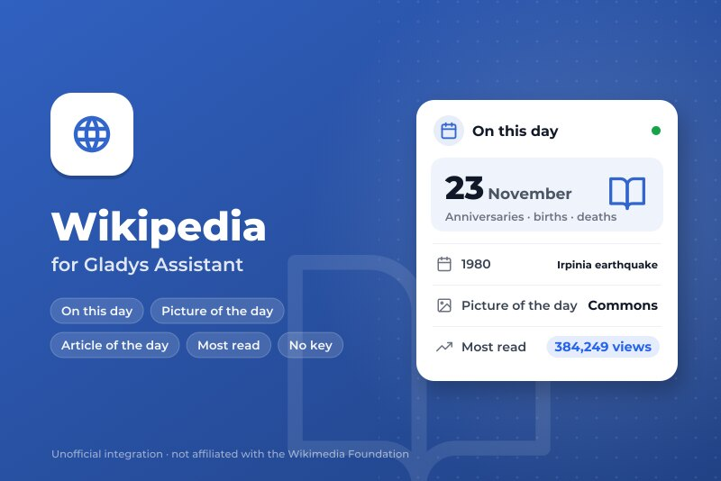
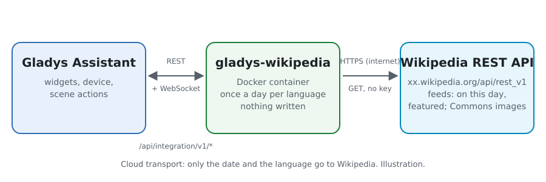
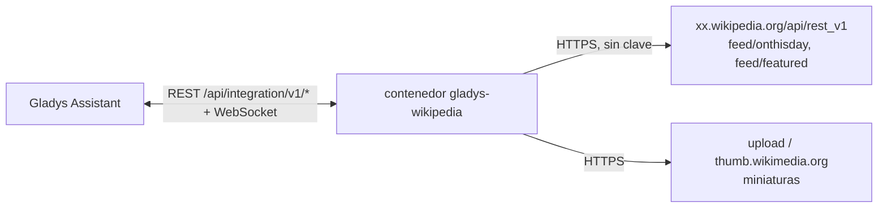
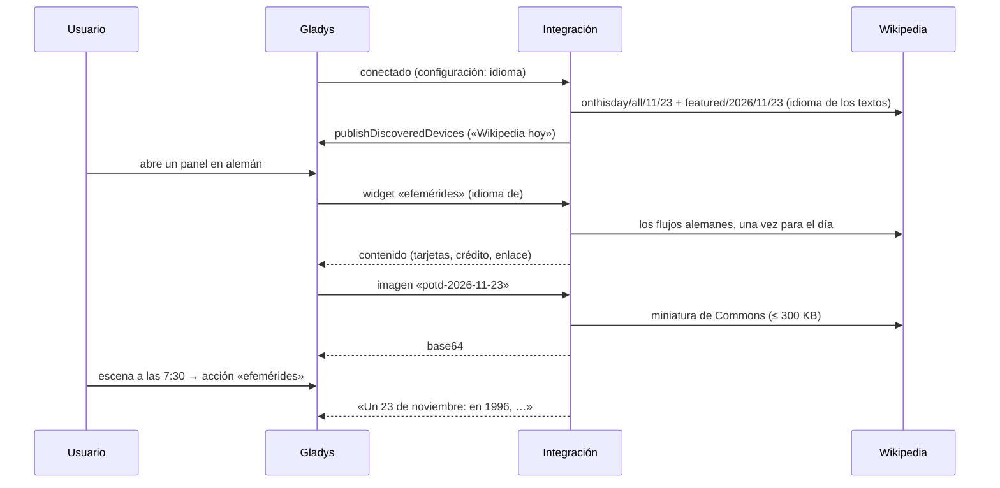
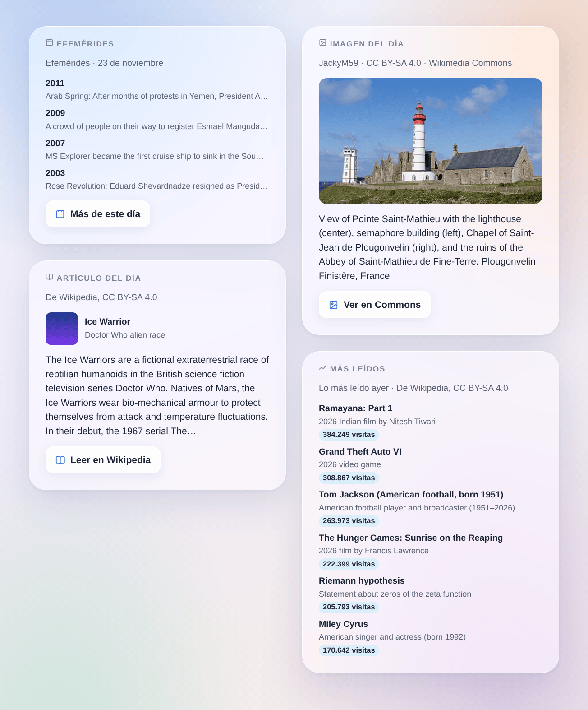

# Gladys Wikipedia

[English](README.md) · [Français](README.fr.md) · [Deutsch](README.de.md) · **Español**

[](LICENSE)
[](https://github.com/William-De71/gladys-wikipedia/releases)
[](https://github.com/William-De71/gladys-wikipedia/actions/workflows/release.yml)
[](https://gladysassistant.com)



Integración externa de [Gladys Assistant](https://gladysassistant.com) para **[Wikipedia](https://es.wikipedia.org)**: lo que pasó tal día como hoy, la imagen del día, el artículo del día y los artículos más leídos, en sus paneles y en sus escenas. Sin cuenta ni clave: lee los flujos públicos de la Wikimedia Foundation, en español, inglés, francés y alemán.

## Funciones

- **4 widgets de panel**, cada uno en la Wikipedia del idioma del panel: efemérides (efemérides seleccionadas, acontecimientos, nacimientos, fallecimientos o celebraciones), imagen del día, artículo del día, más leídos.
- **Un dispositivo** «Wikipedia hoy»: la efeméride, el artículo y la imagen del día como textos, para un panel o una escena.
- **3 acciones de escena**: efemérides, imagen del día, artículo del día, con un texto listo para enviar o leer.
- Cada idioma usado se lee **una vez al día** (dos solicitudes), a la primera necesidad tras la medianoche en la zona horaria de Gladys; no se escribe nada en `/data`.
- Los textos de Wikipedia están bajo CC BY-SA 4.0: cada widget cita a Wikipedia, la imagen su autor y su licencia.
- Cuatro idiomas en todo: inglés, francés, alemán, español.

## Funcionamiento







### Transporte

`transports: ["cloud"]`: todo va a `<idioma>.wikipedia.org` y a los servidores de imágenes de Wikimedia, por HTTPS, con un User-Agent que nombra la integración y su repositorio, como pide la etiqueta de la API de Wikimedia. Solo la fecha y el idioma salen de Gladys: sin cuenta, sin clave, sin datos personales. No se escribe nada en `/data`.

## Dispositivo y funciones

| Dispositivo   | Función          | Categoría / tipo | Contenido                                                |
| ------------- | ---------------- | ---------------- | -------------------------------------------------------- |
| Wikipedia hoy | Efeméride        | `text` / text    | «1996: un Boeing 767 …» (primera efeméride seleccionada) |
|               | Artículo del día | `text` / text    | El artículo del día, si no el más leído de ayer          |
|               | Imagen del día   | `text` / text    | Su descripción                                           |

## Acciones de escena y widgets



- **Acción «Wikipedia: efemérides»**: campos `kind` (efemérides, acontecimientos, nacimientos, fallecimientos, celebraciones) y `count` (1 a 10); salidas `summary` («Un 23 de noviembre: en 1996, …»), `count`, `first_year`, `first_text`, `page_url`.
- **Acción «Wikipedia: imagen del día»**: salidas `description`, `artist`, `license`, `file_url`, `image_url`.
- **Acción «Wikipedia: artículo del día»**: salidas `title`, `description`, `extract`, `url`, `most_read` (verdadero cuando la Wikipedia no tiene artículo del día: francés y español).
- **Widgets**: «Efemérides» (ajuste: qué mostrar; una tarjeta por entrada, el texto completo y los enlaces de los artículos en el panel de detalle, un enlace a la página del día), «Imagen del día» (la imagen, su descripción, autor y licencia, un enlace a Commons), «Artículo del día» (miniatura, inicio del resumen, enlace), «Más leídos» (con sus visitas).

Sin disparador de escena: el contenido cambia una vez al día, basta con una escena programada. Ejemplos:

- _Cada mañana a las 7:30_ → **efemérides** (3 efemérides) → leer `summary` en el altavoz de la cocina.
- _Cada noche a las 20:00_ → **artículo del día** → enviar el título y la dirección por Telegram.
- Un panel con «Efemérides» ajustado en nacimientos: quién nació hoy.

## Requisitos

- Gladys Assistant **5.3.0** o posterior; las instancias más antiguas no pueden instalar la integración.
- Acceso a internet hacia `*.wikipedia.org` y `*.wikimedia.org`. Nada más: sin cuenta ni clave.

## Instalación

- **Desde la tienda**: Integraciones → Wikipedia → Instalar.
- **Desde la URL del repositorio**: Integraciones → integración externa → `https://github.com/William-De71/gladys-wikipedia`.
- **Modo desarrollador**: ejecute `npm start` con las variables que da Gladys (ver Desarrollo).

## Configuración

| Campo                | Por defecto | Significado                                                                                |
| -------------------- | ----------- | ------------------------------------------------------------------------------------------ |
| Idioma de Wikipedia  | Automático  | La Wikipedia del dispositivo y de las acciones de escena; automático: la del último widget |
| Leer Wikipedia ahora | —           | Lee el contenido de hoy y lo muestra                                                       |

Los widgets usan siempre la Wikipedia de su propio idioma.

## Uso

1. Instale la integración; pulse **Leer Wikipedia ahora** si lo desea.
2. Añada los widgets a un panel; elija qué muestra «Efemérides».
3. Descubrimiento: añada «Wikipedia hoy» para los textos; use las acciones de escena en sus escenas.

## Desarrollo

```bash
npm install
npm test                       # node --test, una Wikipedia simulada con respuestas reales, nunca la red
npm run lint                   # ESLint
npm run format:check           # Prettier
npx github:GladysAssistant/integration-store . --skip-image-check
scripts/build-cover.sh         # cover.jpg a partir de docs/assets/cover.svg
docs/illustrations/render.sh   # docs/assets/widgets.<idioma>.png
```

En local, el SDK lee `GLADYS_HOST_API_URL`, `GLADYS_INTEGRATION_TOKEN` y `GLADYS_INTEGRATION_SELECTOR` (que Gladys da en modo desarrollador), y la integración lee `TZ`. `DEBUG=gladys-integration-sdk` muestra los registros del SDK.

Las pruebas cubren el cliente HTTP (User-Agent, reintento, servidores y tamaño de las imágenes), la lectura de los flujos (respuestas reales del 23 de noviembre de 2026), los widgets (`validateWidgetContent`), las imágenes (una miniatura más pequeña si es demasiado grande), el dispositivo, las acciones de escena, el cambio de día, el manifiesto, los cuatro idiomas, el script de publicación y toda la integración contra el Gladys simulado del SDK. `test/structure.test.js` congela los identificadores externos y cada clave que guardan los usuarios.

## Proceso de publicación


Cada fusión en `main` ejecuta la CI y luego calcula la versión a partir de los [Conventional Commits](https://www.conventionalcommits.org/es/) desde la última etiqueta: `feat` → menor, `fix` / `perf` → parche, `!` o `BREAKING CHANGE` → mayor (una menor por debajo de 1.0.0); `docs`, `chore`, `ci`, `test`, `style`, `refactor`, `build` solos no publican nada. Se genera la sección del changelog, se sube la etiqueta, se construye la imagen multiarquitectura, luego `main` recibe el commit de publicación, se crea la GitHub Release y un último job comprueba la imagen pública, el validador de la tienda y el topic.

- El título de la pull request se convierte en el commit squash y luego en la línea del changelog: escríbalo en inglés, para el usuario (`pr-title.yml` lo comprueba). No edite nunca `CHANGELOG.md` a mano.
- La 1.0.0 es una decisión: Actions → Release → Run workflow con `release-as: 1.0.0`. `dry-run` muestra la versión y las notas sin publicar.
- **Rama protegida**: la publicación sube su commit a `main` con `GITHUB_TOKEN`. El ruleset `protect-main` (sin borrado, sin force-push) lo deja pasar; una regla más estricta (pull request obligatoria, status checks) necesitaría GitHub Actions en su lista de excepciones, o una GitHub App.

## Solución de problemas

Ver [docs/es.md](docs/es.md#solución-de-problemas). Informe de los problemas con las versiones de Gladys y de la integración, los idiomas de sus paneles y el mensaje de **Leer Wikipedia ahora**.

## Contribuir

Las issues y pull requests son bienvenidas. Ejecute `npm run format:check && npm run lint && npm test` antes de abrir una pull request y no cambie ningún identificador externo ni ninguna clave guardada (ver [CLAUDE.md](CLAUDE.md)).

## Seguridad

Ver [SECURITY.md](SECURITY.md): informe de las vulnerabilidades en privado. La integración no tiene ningún secreto: solo lee flujos públicos.

## Capturas pendientes

Las imágenes de arriba son ilustraciones, no capturas de pantalla. Las capturas reales irán en `docs/assets/screenshots/` (PNG, 1280 × 800): `dashboard.png` (los cuatro widgets en un panel), `device.png` (el dispositivo «Wikipedia hoy»), `scene.png` (una escena matinal con la acción «efemérides»).

## Licencia

[Licencia Apache 2.0](LICENSE) — ver también [NOTICE](NOTICE). El contenido mostrado procede de Wikipedia (CC BY-SA 4.0, colaboradores de Wikipedia) y de Wikimedia Commons (la licencia de cada imagen). Wikipedia es una marca de la Wikimedia Foundation; este proyecto no está afiliado a la Wikimedia Foundation ni respaldado o patrocinado por ella. Gracias a la documentación y al SDK de Gladys, y a los colaboradores de Wikipedia.
