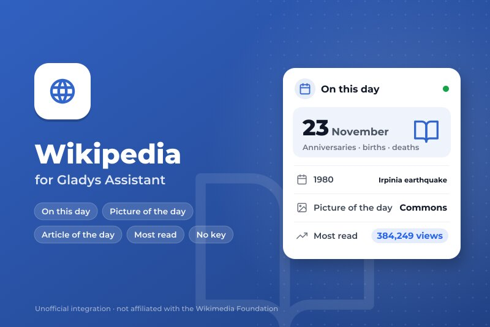
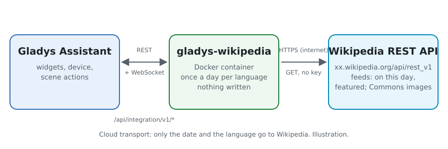
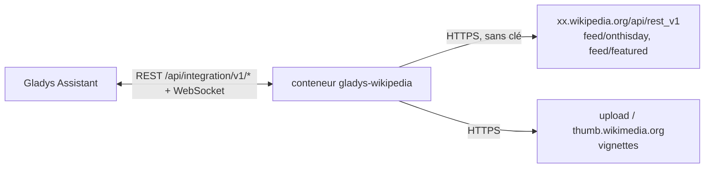
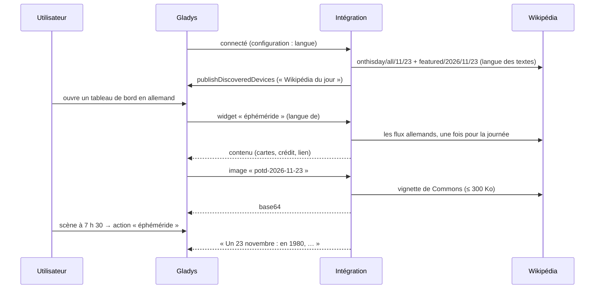
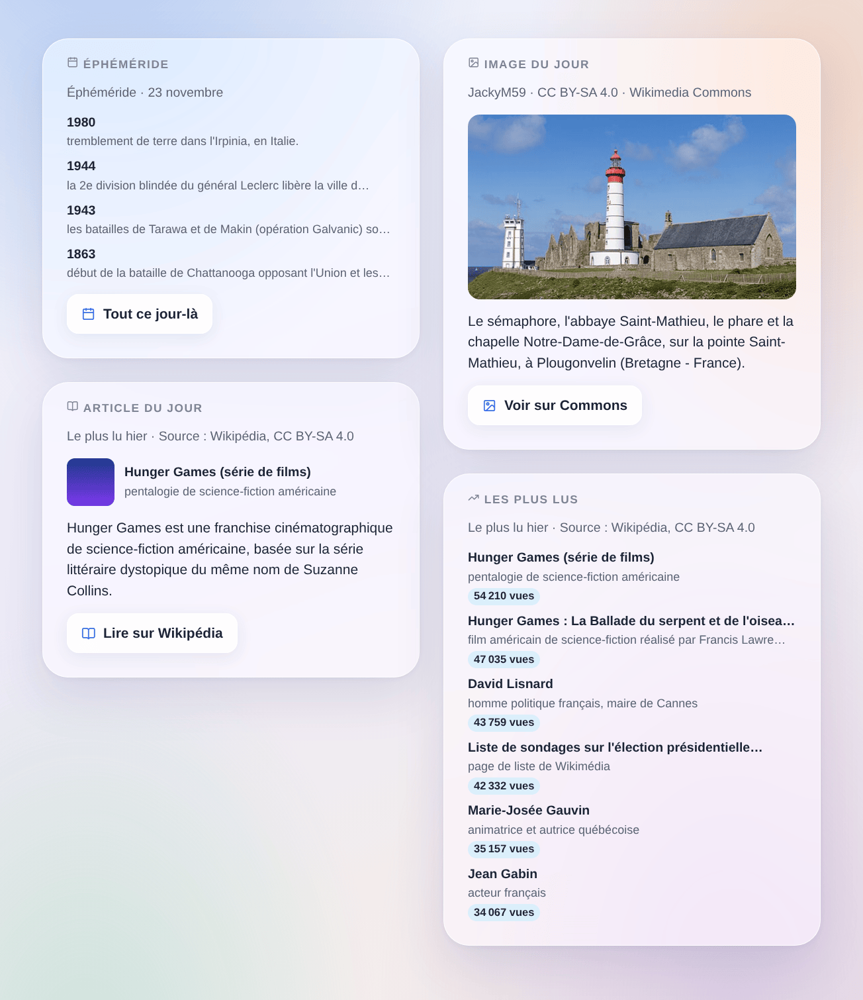

# Gladys Wikipedia

[English](README.md) · **Français** · [Deutsch](README.de.md) · [Español](README.es.md)

[](LICENSE)
[](https://github.com/William-De71/gladys-wikipedia/releases)
[](https://github.com/William-De71/gladys-wikipedia/actions/workflows/release.yml)
[](https://gladysassistant.com)



Intégration externe de [Gladys Assistant](https://gladysassistant.com) pour **[Wikipédia](https://fr.wikipedia.org)** : ce qui s’est passé ce jour-là, l’image du jour, l’article du jour et les articles les plus lus, sur vos tableaux de bord et dans vos scènes. Ni compte ni clé : elle lit les flux publics de la Wikimedia Foundation, en français, anglais, allemand et espagnol.

## Fonctionnalités

- **4 widgets**, chacun dans la Wikipédia de la langue du tableau de bord : éphéméride (anniversaires choisis, événements, naissances, décès ou fêtes), image du jour, article du jour, les plus lus.
- **Un appareil** « Wikipédia du jour » : l’éphéméride, l’article et l’image du jour en textes, pour un tableau de bord ou une scène.
- **3 actions de scène** : éphéméride, image du jour, article du jour, avec un texte prêt à envoyer ou à lire.
- Chaque langue utilisée est lue **une fois par jour** (deux requêtes), au premier besoin après minuit dans le fuseau de Gladys ; rien n’est écrit dans `/data`.
- Les textes de Wikipédia sont sous CC BY-SA 4.0 : chaque widget cite Wikipédia, l’image son auteur et sa licence.
- Quatre langues partout : anglais, français, allemand, espagnol.

## Fonctionnement







### Transport

`transports: ["cloud"]` : tout part vers `<langue>.wikipedia.org` et les serveurs d’images de Wikimedia, en HTTPS, avec un User-Agent qui nomme l’intégration et son dépôt, comme le demande l’étiquette de l’API Wikimedia. Seuls la date et la langue sortent de Gladys : ni compte, ni clé, ni donnée personnelle. Rien n’est écrit dans `/data`.

## Appareil et fonctionnalités

| Appareil          | Fonctionnalité  | Catégorie / type | Contenu                                                        |
| ----------------- | --------------- | ---------------- | -------------------------------------------------------------- |
| Wikipédia du jour | Éphéméride      | `text` / text    | « 1980 : tremblement de terre… » (premier anniversaire choisi) |
|                   | Article du jour | `text` / text    | L’article du jour, sinon le plus lu d’hier                     |
|                   | Image du jour   | `text` / text    | Sa description                                                 |

## Actions de scène et widgets



- **Action « Wikipédia : éphéméride »** : champs `kind` (anniversaires choisis, événements, naissances, décès, fêtes) et `count` (1 à 10) ; sorties `summary` (« Un 23 novembre : en 1980, … »), `count`, `first_year`, `first_text`, `page_url`.
- **Action « Wikipédia : image du jour »** : sorties `description`, `artist`, `license`, `file_url`, `image_url`.
- **Action « Wikipédia : article du jour »** : sorties `title`, `description`, `extract`, `url`, `most_read` (vrai quand la Wikipédia n’a pas d’article du jour : français et espagnol).
- **Widgets** : « Éphéméride » (réglage : quoi afficher ; une carte par entrée, le texte complet et les liens des articles dans le panneau de détail, un lien vers la page du jour), « Image du jour » (l’image, sa description, son auteur et sa licence, un lien vers Commons), « Article du jour » (vignette, début du résumé, lien), « Les plus lus » (avec leurs vues).

Pas de déclencheur de scène : le contenu change une fois par jour, une scène à heure fixe suffit. Exemples :

- _Chaque matin à 7 h 30_ → **éphéméride** (3 anniversaires) → lire `summary` sur l’enceinte de la cuisine.
- _Chaque soir à 20 h_ → **article du jour** → envoyer le titre et l’adresse par Telegram.
- Un tableau de bord avec « Éphéméride » réglé sur les naissances : qui est né aujourd’hui.

## Prérequis

- Gladys Assistant **5.3.0** ou plus récent ; les instances plus anciennes ne peuvent pas installer l’intégration.
- Un accès Internet vers `*.wikipedia.org` et `*.wikimedia.org`. Rien d’autre : ni compte, ni clé.

## Installation

- **Depuis le store** : Intégrations → Wikipedia → Installer.
- **Depuis l’URL du dépôt** : Intégrations → intégration externe → `https://github.com/William-De71/gladys-wikipedia`.
- **Mode développeur** : lancez `npm start` avec les variables fournies par Gladys (voir Développement).

## Configuration

| Champ                     | Défaut      | Rôle                                                                                       |
| ------------------------- | ----------- | ------------------------------------------------------------------------------------------ |
| Langue de Wikipédia       | Automatique | La Wikipédia de l’appareil et des actions de scène ; automatique : celle du dernier widget |
| Lire Wikipédia maintenant | —           | Lit le contenu du jour et l’affiche                                                        |

Les widgets utilisent toujours la Wikipédia de leur langue.

## Utilisation

1. Installez l’intégration ; appuyez sur **Lire Wikipédia maintenant** si vous voulez.
2. Ajoutez les widgets à un tableau de bord ; choisissez ce qu’affiche « Éphéméride ».
3. Découverte : ajoutez « Wikipédia du jour » pour les textes ; utilisez les actions de scène dans vos scènes.

## Développement

```bash
npm install
npm test                       # node --test, une fausse Wikipédia aux vraies réponses, jamais le réseau
npm run lint                   # ESLint
npm run format:check           # Prettier
npx github:GladysAssistant/integration-store . --skip-image-check
scripts/build-cover.sh         # cover.jpg depuis docs/assets/cover.svg
docs/illustrations/render.sh   # docs/assets/widgets.<langue>.png
```

En local, le SDK lit `GLADYS_HOST_API_URL`, `GLADYS_INTEGRATION_TOKEN` et `GLADYS_INTEGRATION_SELECTOR` (fournies par Gladys en mode développeur), et l’intégration lit `TZ`. `DEBUG=gladys-integration-sdk` affiche les journaux du SDK.

Les tests couvrent le client HTTP (User-Agent, nouvel essai, hôtes et taille des images), la lecture des flux (vraies réponses du 23 novembre 2026), les widgets (`validateWidgetContent`), les images (une vignette plus petite si trop lourde), l’appareil, les actions de scène, le changement de jour, le manifeste, les quatre langues, le script de release et toute l’intégration contre le faux Gladys du SDK. `test/structure.test.js` fige les identifiants externes et chaque clé enregistrée par les utilisateurs.

## Processus de release


Chaque fusion sur `main` lance la CI, puis calcule la version à partir des [Conventional Commits](https://www.conventionalcommits.org/fr/) depuis le dernier tag : `feat` → mineure, `fix` / `perf` → correctif, `!` ou `BREAKING CHANGE` → majeure (une mineure sous 1.0.0) ; `docs`, `chore`, `ci`, `test`, `style`, `refactor`, `build` seuls ne publient rien. La section du changelog est générée, le tag poussé, l’image multi-architecture construite, puis `main` reçoit le commit de release, la GitHub Release est créée et un dernier job vérifie l’image publique, le validateur du store et le topic.

- Le titre de la pull request devient le commit squash, puis la ligne du changelog : écrivez-le en anglais, pour l’utilisateur (`pr-title.yml` le vérifie). N’éditez jamais `CHANGELOG.md` à la main.
- La 1.0.0 est une décision : Actions → Release → Run workflow avec `release-as: 1.0.0`. `dry-run` affiche la version et les notes sans rien publier.
- **Branche protégée** : des rulesets imposent une pull request sur `main` et verrouillent les tags `v*` ; seuls le mainteneur et les deploy keys passent. La release pousse avec la deploy key de l’environnement `release` (secret `RELEASE_DEPLOY_KEY`, `main` seulement) : un run lancé depuis une autre branche ne l’obtient jamais. `build.yml` et `github-release.yml` ne démarrent pas sur un tag : la release les appelle, ou lancez-les à la main (Actions → Run workflow, avec `version` pour l’image) pour terminer une release.

## Dépannage

Voir [docs/fr.md](docs/fr.md#dépannage). Signalez un problème avec les versions de Gladys et de l’intégration, les langues de vos tableaux de bord et le message de **Lire Wikipédia maintenant**.

## Contribuer

Les issues et pull requests sont bienvenues. Lancez `npm run format:check && npm run lint && npm test` avant d’ouvrir une pull request, et ne changez aucun identifiant externe ni aucune clé enregistrée (voir [CLAUDE.md](CLAUDE.md)).

## Sécurité

Voir [SECURITY.md](SECURITY.md) : signalez les vulnérabilités en privé. L’intégration n’a aucun secret : elle ne lit que des flux publics.

## Captures à venir

Les images ci-dessus sont des illustrations, pas des captures d’écran. Les vraies captures iront dans `docs/assets/screenshots/` (PNG, 1280 × 800) : `dashboard.png` (les quatre widgets sur un tableau de bord), `device.png` (l’appareil « Wikipédia du jour »), `scene.png` (une scène du matin avec l’action « éphéméride »).

## Licence

[Licence Apache 2.0](LICENSE) — voir aussi [NOTICE](NOTICE). Le contenu affiché vient de Wikipédia (CC BY-SA 4.0, contributeurs de Wikipédia) et de Wikimedia Commons (la licence de chaque image). Wikipédia est une marque de la Wikimedia Foundation ; ce projet n’est ni affilié à la Wikimedia Foundation, ni approuvé ou sponsorisé par elle. Merci à la documentation et au SDK de Gladys, et aux contributeurs de Wikipédia.
