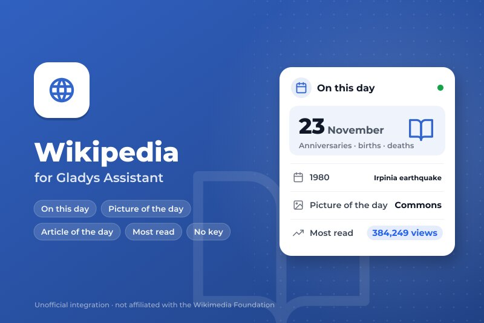
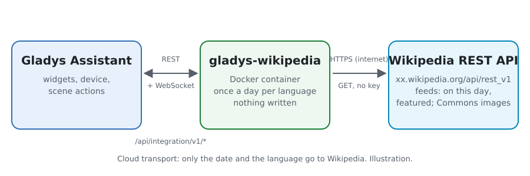
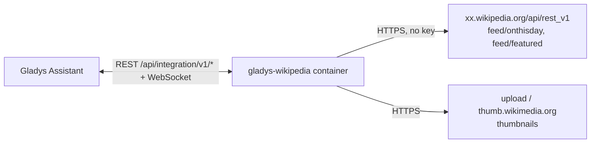
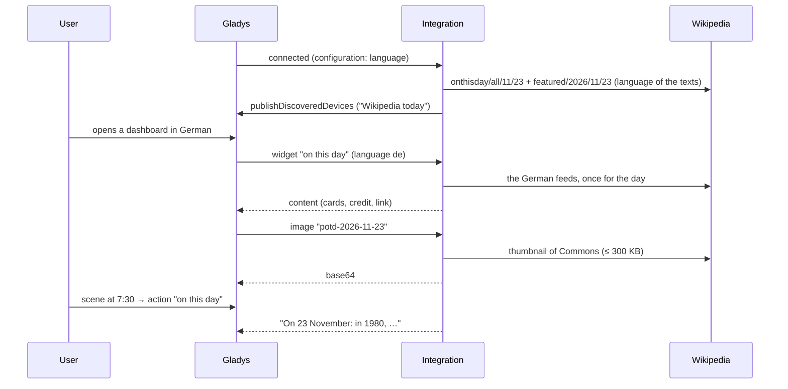
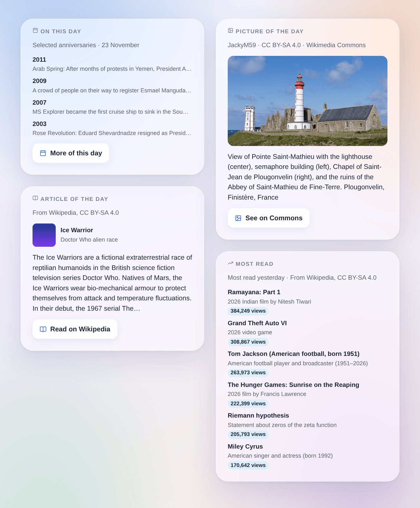

# Gladys Wikipedia

**English** · [Français](README.fr.md) · [Deutsch](README.de.md) · [Español](README.es.md)

[](LICENSE)
[](https://github.com/William-De71/gladys-wikipedia/releases)
[](https://github.com/William-De71/gladys-wikipedia/actions/workflows/release.yml)
[](https://gladysassistant.com)



[Gladys Assistant](https://gladysassistant.com) external integration for **[Wikipedia](https://www.wikipedia.org)**: what happened on this day, the picture of the day, the article of the day and the most read articles, on your dashboards and in your scenes. No account and no key: it reads the public feeds of the Wikimedia Foundation, in English, French, German and Spanish.

## Features

- **4 dashboard widgets**, each in the Wikipedia of the language of the dashboard: on this day (selected anniversaries, events, births, deaths or holidays), picture of the day, article of the day, most read.
- **A device** "Wikipedia today": today's anniversary, article and picture as texts, for a dashboard or a scene.
- **3 scene actions**: on this day, picture of the day, article of the day, with a text ready to send or to speak.
- Each language in use is read **once a day** (two requests), at the first need after midnight in the timezone of Gladys; nothing is written to `/data`.
- Wikipedia texts are under CC BY-SA 4.0: every widget credits Wikipedia, the picture its author and licence.
- Four languages everywhere: English, French, German, Spanish.

## How it works







### Transport

`transports: ["cloud"]`: everything goes to `<language>.wikipedia.org` and to the image servers of Wikimedia, over HTTPS, with a User-Agent naming the integration and its repository, as the Wikimedia API etiquette asks. Only the date and the language leave Gladys: no account, no key, no personal data. Nothing is written to `/data`.

## Device and features

| Device          | Feature            | Category / type | Content                                                   |
| --------------- | ------------------ | --------------- | --------------------------------------------------------- |
| Wikipedia today | On this day        | `text` / text   | "1980: an earthquake…" (first selected anniversary)       |
|                 | Article of the day | `text` / text   | The featured article, else the most read one of yesterday |
|                 | Picture of the day | `text` / text   | Its description                                           |

## Scene actions and widgets



- **Action "Wikipedia: on this day"**: fields `kind` (selected, events, births, deaths, holidays) and `count` (1 to 10); outputs `summary` ("On 23 November: in 1980, …"), `count`, `first_year`, `first_text`, `page_url`.
- **Action "Wikipedia: picture of the day"**: outputs `description`, `artist`, `license`, `file_url`, `image_url`.
- **Action "Wikipedia: article of the day"**: outputs `title`, `description`, `extract`, `url`, `most_read` (true when the Wikipedia has no featured article: French and Spanish).
- **Widgets**: "On this day" (setting: what to show; one card per entry, the full text and the article links in the detail panel, a link to the page of the day), "Picture of the day" (the image, its description, author and licence, a link to Commons), "Article of the day" (thumbnail, start of the summary, link), "Most read" (with their views).

No scene trigger: the content changes once a day, a schedule in a scene catches it. Examples:

- _Every morning at 7:30_ → **on this day** (3 anniversaries) → speak `summary` on the speaker of the kitchen.
- _Every evening at 20:00_ → **article of the day** → send the title and the address by Telegram.
- A dashboard with "On this day" set on births: who was born today.

## Requirements

- Gladys Assistant **5.3.0** or later; older instances cannot install the integration.
- Internet access to `*.wikipedia.org` and `*.wikimedia.org`. Nothing else: no account, no key.

## Installation

- **From the store**: Integrations → Wikipedia → Install.
- **From the repository URL**: Integrations → external integration → `https://github.com/William-De71/gladys-wikipedia`.
- **Developer mode**: run `npm start` with the variables given by Gladys (see Development).

## Configuration

| Field                 | Default   | Meaning                                                                                  |
| --------------------- | --------- | ---------------------------------------------------------------------------------------- |
| Language of Wikipedia | Automatic | The Wikipedia of the device and the scene actions; automatic: the one of the last widget |
| Read Wikipedia now    | —         | Reads the content of today and shows it                                                  |

The widgets always use the Wikipedia of their own language.

## Usage

1. Install the integration; press **Read Wikipedia now** if you wish.
2. Add the widgets to a dashboard; choose what "On this day" shows.
3. Discovery: add "Wikipedia today" for the texts; use the scene actions in your scenes.

## Development

```bash
npm install
npm test                       # node --test, a fake Wikipedia with real answers, never the network
npm run lint                   # ESLint
npm run format:check           # Prettier
npx github:GladysAssistant/integration-store . --skip-image-check
scripts/build-cover.sh         # cover.jpg from docs/assets/cover.svg
docs/illustrations/render.sh   # docs/assets/widgets.<lang>.png
```

Locally, the SDK reads `GLADYS_HOST_API_URL`, `GLADYS_INTEGRATION_TOKEN` and `GLADYS_INTEGRATION_SELECTOR` (given by Gladys in developer mode), and the integration reads `TZ`. `DEBUG=gladys-integration-sdk` shows the SDK logs.

The tests cover the HTTP client (User-Agent, retry, image hosts and size), the reading of the feeds (real answers of 23 November 2026), the widgets (`validateWidgetContent`), the images (a smaller thumbnail when too large), the device, the scene actions, the change of day, the manifest, the four languages, the release script and the whole integration against the fake Gladys of the SDK. `test/structure.test.js` freezes the external ids and every key users store.

## Release process


Every merge on `main` runs the CI, then computes the version from the [Conventional Commits](https://www.conventionalcommits.org/) since the last tag: `feat` → minor, `fix` / `perf` → patch, `!` or `BREAKING CHANGE` → major (a minor below 1.0.0); `docs`, `chore`, `ci`, `test`, `style`, `refactor`, `build` alone publish nothing. The changelog section is generated, the tag pushed, the multi-architecture image built, then `main` receives the release commit, the GitHub Release is created and a last job checks the public image, the store validator and the topic.

- The pull request title becomes the squash commit, then the changelog line: write it in English, for the user (`pr-title.yml` checks it). Never edit `CHANGELOG.md` by hand.
- 1.0.0 is a decision: Actions → Release → Run workflow with `release-as: 1.0.0`. `dry-run` shows the version and the notes without publishing.
- **Protected branch**: the release pushes its commit to `main` with `GITHUB_TOKEN`. The `protect-main` ruleset (no deletion, no force-push) lets it through; a stricter rule (pull request required, status checks) would need GitHub Actions in its bypass list, or a GitHub App.

## Troubleshooting

See [docs/en.md](docs/en.md#troubleshooting). Report issues with the versions of Gladys and of the integration, the languages of your dashboards and the message of **Read Wikipedia now**.

## Contributing

Issues and pull requests are welcome. Run `npm run format:check && npm run lint && npm test` before opening a pull request, and keep every external id and stored key unchanged (see [CLAUDE.md](CLAUDE.md)).

## Security

See [SECURITY.md](SECURITY.md): report vulnerabilities privately. The integration has no secret: it reads public feeds only.

## Screenshots to come

The images above are illustrations, not screenshots. Real screenshots will go in `docs/assets/screenshots/` (PNG, 1280 × 800): `dashboard.png` (the four widgets on a dashboard), `device.png` (the "Wikipedia today" device), `scene.png` (a morning scene with the "on this day" action).

## License

[Apache License 2.0](LICENSE) — see also [NOTICE](NOTICE). The content shown comes from Wikipedia (CC BY-SA 4.0, Wikipedia contributors) and Wikimedia Commons (the licence of each picture). Wikipedia is a trademark of the Wikimedia Foundation; this project is not affiliated with, endorsed or sponsored by the Wikimedia Foundation. Thanks to the Gladys documentation and SDK, and to the Wikipedia contributors.
