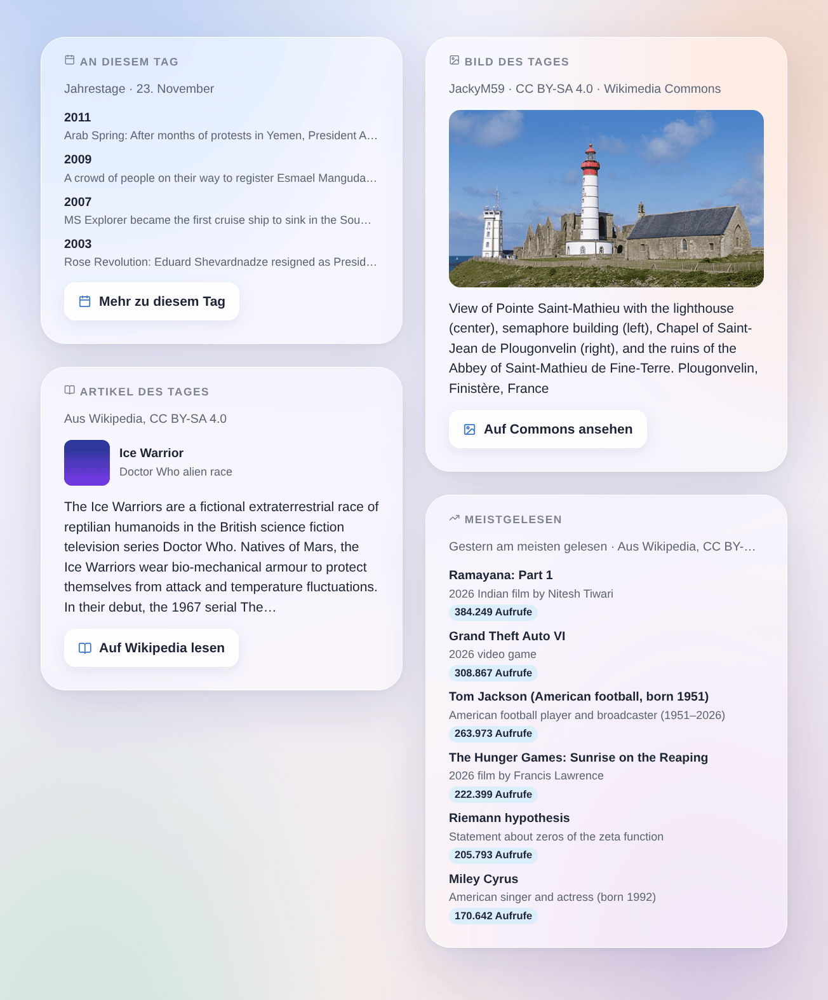

# Wikipedia

## Überblick

Diese Integration bringt den täglichen Inhalt von **Wikipedia** in Gladys: was an diesem Tag geschah (Jahrestage, Ereignisse, Geburten, Todesfälle, Feiertage), das Bild des Tages von Wikimedia Commons, den Artikel des Tages und die gestern meistgelesenen Artikel. Jedes Widget zeigt die Wikipedia der Sprache seines Dashboards: Deutsch, Englisch, Französisch oder Spanisch.

Sie bringt vier Dashboard-Widgets, ein Gerät „Wikipedia heute“, dessen Texte Szenen nutzen können, und drei Szenenaktionen, die einen Text zum Senden oder Vorlesen liefern, etwa „Am 23. November: 1976: …“ in einer Morgennachricht.

## Voraussetzungen

- Gladys Assistant 5.3.0 oder neuer.
- Internetzugang. Sonst nichts: kein Konto, kein Schlüssel. Nur das Datum und die Sprache verlassen Gladys.

## Konfiguration

| Feld                  | Standard    | Bedeutung                                                                             |
| --------------------- | ----------- | ------------------------------------------------------------------------------------- |
| Sprache von Wikipedia | Automatisch | Die Wikipedia des Geräts und der Szenenaktionen; automatisch: die des letzten Widgets |
| Wikipedia jetzt lesen | —           | Liest den Inhalt von heute und zeigt ihn an                                           |

Die Widgets nutzen immer die Wikipedia ihrer eigenen Sprache. Jede genutzte Sprache wird einmal am Tag gelesen.

## Verwendung

### Dashboard-Widgets

- **An diesem Tag**: Wähle, was es zeigt (ausgewählte Jahrestage, Ereignisse, Geburten, Todesfälle, Feiertage). Eine Karte pro Eintrag mit seinem Jahr; tippe darauf für den vollständigen Text und die Artikellinks. Eine Schaltfläche öffnet die Tagesseite auf Wikipedia.
- **Bild des Tages**: das Bild von Wikimedia Commons, seine Beschreibung, sein Urheber und seine Lizenz, ein Link zu Commons.
- **Artikel des Tages**: der hervorgehobene Artikel (die deutsche und die englische Wikipedia wählen jeden Tag einen); die französische und die spanische Wikipedia haben keinen, dann tritt der gestern meistgelesene Artikel an seine Stelle, was das Widget anzeigt.
- **Meistgelesen**: die gestern meistgelesenen Artikel mit ihren Aufrufen.

### Gerät

„Wikipedia heute“ (Erkennungsbildschirm) hat drei Texte, jeden Tag erneuert: der erste ausgewählte Jahrestag, der Artikel des Tages und die Beschreibung des Bildes des Tages.

### Szenen

- **Aktion „Wikipedia: an diesem Tag“**: was (Jahrestage, Ereignisse, Geburten, Todesfälle, Feiertage) und wie viele (1 bis 10); liefert einen Text, „Am 23. November: 1976: …“, Jahr und Text des ersten Eintrags und die Adresse der Tagesseite.
- **Aktion „Wikipedia: Bild des Tages“**: seine Beschreibung, Urheber, Lizenz, Seite auf Commons und Bildadresse.
- **Aktion „Wikipedia: Artikel des Tages“**: Titel, Kurzbeschreibung, Zusammenfassung und Adresse; „stattdessen meistgelesen“ zeigt an, wenn es der meistgelesene Artikel ist.

Beispiele: Jeden Morgen um 7:30 „an diesem Tag“ auf dem Lautsprecher in der Küche vorlesen; jeden Abend den Artikel des Tages per Telegram senden.

### Lizenz des Inhalts

Die Texte von Wikipedia stehen unter CC BY-SA 4.0: Die Widgets nennen Wikipedia; das Bild des Tages zeigt seinen Urheber und seine Lizenz. Weitergegeben (eine Nachricht, ein Beitrag) behält der Inhalt dieselbe Lizenz.

## Fehlerbehebung

- **„wikipedia.org ist nicht erreichbar“**: Prüfe den Internetzugang von Gladys (`*.wikipedia.org`, `*.wikimedia.org`).
- **„Wikipedia bittet, langsamer zu werden“**: Die nächste Abfrage versucht es erneut; bei einer Abfrage am Tag sollte das nicht vorkommen.
- **Das Bild erscheint nicht**: Die Bildserver von Wikimedia waren nicht erreichbar oder das Bild ist zu groß; die nächste Anzeige versucht es erneut.
- **Kurz nach Mitternacht das Bild oder der Artikel vom Vortag**: Die Feeds von Wikimedia folgen UTC; der Inhalt des neuen Tages kommt, sobald sie ihn veröffentlichen (30 Minuten später erneut gelesen).
- Protokolle: Einstellungen → Supervision, die Protokolle der Integration.
