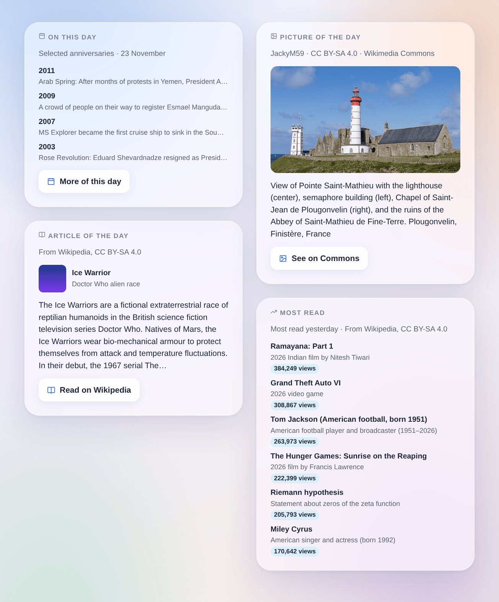

# Wikipedia

## Overview

This integration brings the daily content of **Wikipedia** into Gladys: what happened on this day (anniversaries, events, births, deaths, holidays), the picture of the day of Wikimedia Commons, the article of the day and the articles read most yesterday. Each widget shows the Wikipedia of the language of its dashboard: English, French, German or Spanish.

It adds four dashboard widgets, a "Wikipedia today" device whose texts scenes can use, and three scene actions that give a text ready to send or to speak, such as "On 23 November: in 1980, …" in a morning message.

## Prerequisites

- Gladys Assistant 5.3.0 or later.
- Internet access. Nothing else: no account, no key. Only the date and the language leave Gladys.

## Configuration

| Field                 | Default   | Meaning                                                                                  |
| --------------------- | --------- | ---------------------------------------------------------------------------------------- |
| Language of Wikipedia | Automatic | The Wikipedia of the device and the scene actions; automatic: the one of the last widget |
| Read Wikipedia now    | —         | Reads the content of today and shows it                                                  |

The widgets always use the Wikipedia of their own language. Each language in use is read once a day.

## Usage

### Dashboard widgets

- **On this day**: choose what it shows (selected anniversaries, events, births, deaths, holidays). One card per entry, with its year; tap it for the full text and the links to the articles. A button opens the page of the day on Wikipedia.
- **Picture of the day**: the picture of Wikimedia Commons, its description, its author and licence, a link to Commons.
- **Article of the day**: the featured article (the English and German Wikipedia choose one every day); the French and Spanish Wikipedia have none, so the most read article of yesterday takes its place, which the widget says.
- **Most read**: the articles read most yesterday, with their views.

### Device

"Wikipedia today" (Discovery screen) has three texts, renewed every day: the first selected anniversary, the article of the day and the description of the picture of the day.

### Scenes

- **Action "Wikipedia: on this day"**: what (anniversaries, events, births, deaths, holidays) and how many (1 to 10); gives one text, "On 23 November: in 1980, …", the year and the text of the first one, and the address of the page of the day.
- **Action "Wikipedia: picture of the day"**: its description, author, licence, page on Commons and image address.
- **Action "Wikipedia: article of the day"**: its title, short description, summary and address; "most read" tells when it is the most read article instead.

Examples: every morning at 7:30, speak "on this day" on the speaker of the kitchen; every evening, send the article of the day by Telegram.

### Licence of the content

The texts of Wikipedia are under CC BY-SA 4.0: the widgets credit Wikipedia; the picture of the day shows its author and licence. Shared further (a message, a post), the content keeps the same licence.

## Troubleshooting

- **"Cannot reach wikipedia.org"**: check the internet access of Gladys (`*.wikipedia.org`, `*.wikimedia.org`).
- **"Wikipedia asks to slow down"**: the next reading tries again; this should not happen with one reading a day.
- **The picture does not show**: the image servers of Wikimedia were not reachable, or the picture is too large; the next display tries again.
- **Just after midnight, the picture or the article of the day before**: the feeds of Wikimedia follow UTC; the content of the new day comes once they publish it (read again 30 minutes later).
- Logs: Settings → Supervision, the logs of the integration.
