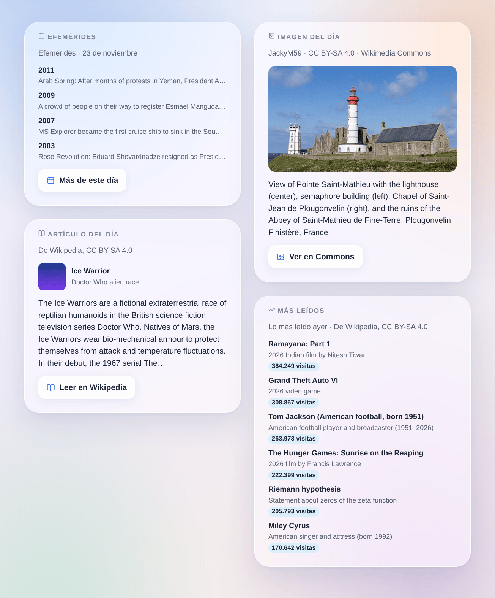

# Wikipedia

## Presentación

Esta integración lleva el contenido diario de **Wikipedia** a Gladys: lo que pasó tal día como hoy (efemérides, acontecimientos, nacimientos, fallecimientos, celebraciones), la imagen del día de Wikimedia Commons, el artículo del día y los artículos más leídos ayer. Cada widget muestra la Wikipedia del idioma de su panel: español, inglés, francés o alemán.

Añade cuatro widgets de panel, un dispositivo «Wikipedia hoy» cuyos textos pueden usar las escenas, y tres acciones de escena que dan un texto listo para enviar o leer, como «Un 23 de noviembre: en 1996, …» en un mensaje matinal.

## Requisitos

- Gladys Assistant 5.3.0 o posterior.
- Acceso a internet. Nada más: sin cuenta ni clave. Solo la fecha y el idioma salen de Gladys.

## Configuración

| Campo                | Por defecto | Significado                                                                                |
| -------------------- | ----------- | ------------------------------------------------------------------------------------------ |
| Idioma de Wikipedia  | Automático  | La Wikipedia del dispositivo y de las acciones de escena; automático: la del último widget |
| Leer Wikipedia ahora | —           | Lee el contenido de hoy y lo muestra                                                       |

Los widgets usan siempre la Wikipedia de su propio idioma. Cada idioma usado se lee una vez al día.

## Uso

### Widgets del panel

- **Efemérides**: elija qué muestra (efemérides seleccionadas, acontecimientos, nacimientos, fallecimientos, celebraciones). Una tarjeta por entrada, con su año; tóquela para ver el texto completo y los enlaces de los artículos. Un botón abre la página del día en Wikipedia.
- **Imagen del día**: la imagen de Wikimedia Commons, su descripción, su autor y su licencia, un enlace a Commons.
- **Artículo del día**: el artículo destacado (las Wikipedia inglesa y alemana eligen uno cada día); las Wikipedia francesa y española no tienen, así que el artículo más leído de ayer ocupa su lugar, lo que el widget indica.
- **Más leídos**: los artículos más leídos ayer, con sus visitas.

### Dispositivo

«Wikipedia hoy» (pantalla de descubrimiento) tiene tres textos, renovados cada día: la primera efeméride seleccionada, el artículo del día y la descripción de la imagen del día.

### Escenas

- **Acción «Wikipedia: efemérides»**: qué (efemérides, acontecimientos, nacimientos, fallecimientos, celebraciones) y cuántos (1 a 10); da un texto, «Un 23 de noviembre: en 1996, …», el año y el texto de la primera, y la dirección de la página del día.
- **Acción «Wikipedia: imagen del día»**: su descripción, autor, licencia, página en Commons y dirección de la imagen.
- **Acción «Wikipedia: artículo del día»**: su título, descripción corta, resumen y dirección; «el más leído en su lugar» indica cuándo es el artículo más leído.

Ejemplos: cada mañana a las 7:30, leer las efemérides en el altavoz de la cocina; cada noche, enviar el artículo del día por Telegram.

### Licencia del contenido

Los textos de Wikipedia están bajo CC BY-SA 4.0: los widgets citan a Wikipedia; la imagen del día muestra su autor y su licencia. Compartido más allá (un mensaje, una publicación), el contenido conserva la misma licencia.

## Solución de problemas

- **«No se puede acceder a wikipedia.org»**: compruebe el acceso a internet de Gladys (`*.wikipedia.org`, `*.wikimedia.org`).
- **«Wikipedia pide ir más despacio»**: la próxima lectura lo vuelve a intentar; no debería ocurrir con una lectura al día.
- **La imagen no aparece**: los servidores de imágenes de Wikimedia no estaban accesibles, o la imagen es demasiado grande; la próxima visualización lo vuelve a intentar.
- **Justo después de medianoche, la imagen o el artículo del día anterior**: los flujos de Wikimedia siguen la hora UTC; el contenido del nuevo día llega en cuanto lo publican (releído 30 minutos después).
- Registros: Ajustes → Supervisión, los registros de la integración.
