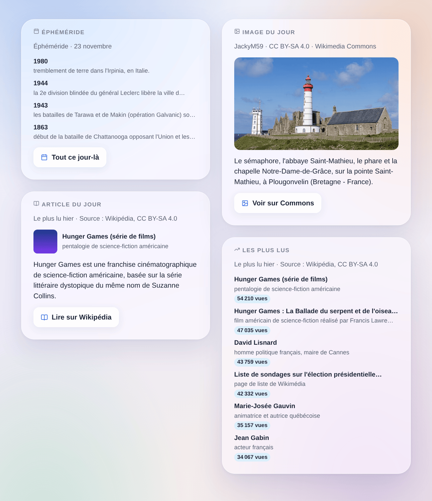

# Wikipédia

## Présentation

Cette intégration amène le contenu quotidien de **Wikipédia** dans Gladys : ce qui s’est passé ce jour-là (anniversaires, événements, naissances, décès, fêtes), l’image du jour de Wikimedia Commons, l’article du jour et les articles les plus lus hier. Chaque widget montre la Wikipédia de la langue de son tableau de bord : français, anglais, allemand ou espagnol.

Elle ajoute quatre widgets, un appareil « Wikipédia du jour » dont les textes servent aux scènes, et trois actions de scène qui donnent un texte prêt à envoyer ou à lire, comme « Un 23 novembre : en 1980, … » dans un message du matin.

## Prérequis

- Gladys Assistant 5.3.0 ou plus récent.
- Un accès Internet. Rien d’autre : ni compte, ni clé. Seuls la date et la langue sortent de Gladys.

## Configuration

| Champ                     | Défaut      | Rôle                                                                                       |
| ------------------------- | ----------- | ------------------------------------------------------------------------------------------ |
| Langue de Wikipédia       | Automatique | La Wikipédia de l’appareil et des actions de scène ; automatique : celle du dernier widget |
| Lire Wikipédia maintenant | —           | Lit le contenu du jour et l’affiche                                                        |

Les widgets utilisent toujours la Wikipédia de leur langue. Chaque langue utilisée est lue une fois par jour.

## Utilisation

### Widgets du tableau de bord

- **Éphéméride** : choisissez ce qu’il affiche (anniversaires choisis, événements, naissances, décès, fêtes). Une carte par entrée, avec son année ; touchez-la pour le texte complet et les liens des articles. Un bouton ouvre la page du jour sur Wikipédia.
- **Image du jour** : l’image de Wikimedia Commons, sa description, son auteur et sa licence, un lien vers Commons.
- **Article du jour** : l’article mis en avant (les Wikipédia anglaise et allemande en choisissent un chaque jour) ; les Wikipédia française et espagnole n’en ont pas, l’article le plus lu d’hier prend alors sa place, ce que le widget indique.
- **Les plus lus** : les articles les plus lus hier, avec leurs vues.

### Appareil

« Wikipédia du jour » (écran de découverte) a trois textes, renouvelés chaque jour : le premier anniversaire choisi, l’article du jour et la description de l’image du jour.

### Scènes

- **Action « Wikipédia : éphéméride »** : quoi (anniversaires, événements, naissances, décès, fêtes) et combien (1 à 10) ; donne un texte, « Un 23 novembre : en 1980, … », l’année et le texte du premier, et l’adresse de la page du jour.
- **Action « Wikipédia : image du jour »** : sa description, son auteur, sa licence, sa page sur Commons et l’adresse de l’image.
- **Action « Wikipédia : article du jour »** : son titre, sa description courte, son résumé et son adresse ; « le plus lu à la place » indique quand c’est l’article le plus lu.

Exemples : chaque matin à 7 h 30, lire l’éphéméride sur l’enceinte de la cuisine ; chaque soir, envoyer l’article du jour par Telegram.

### Licence du contenu

Les textes de Wikipédia sont sous CC BY-SA 4.0 : les widgets citent Wikipédia ; l’image du jour affiche son auteur et sa licence. Partagé plus loin (un message, une publication), le contenu garde la même licence.

## Dépannage

- **« Impossible de joindre wikipedia.org »** : vérifiez l’accès Internet de Gladys (`*.wikipedia.org`, `*.wikimedia.org`).
- **« Wikipédia demande de ralentir »** : la prochaine lecture réessaie ; cela ne devrait pas arriver avec une lecture par jour.
- **L’image ne s’affiche pas** : les serveurs d’images de Wikimedia étaient injoignables, ou l’image est trop lourde ; le prochain affichage réessaie.
- **Juste après minuit, l’image ou l’article de la veille** : les flux de Wikimedia suivent l’heure UTC ; le contenu du nouveau jour arrive dès qu’ils le publient (relu 30 minutes plus tard).
- Journaux : Paramètres → Supervision, les journaux de l’intégration.
